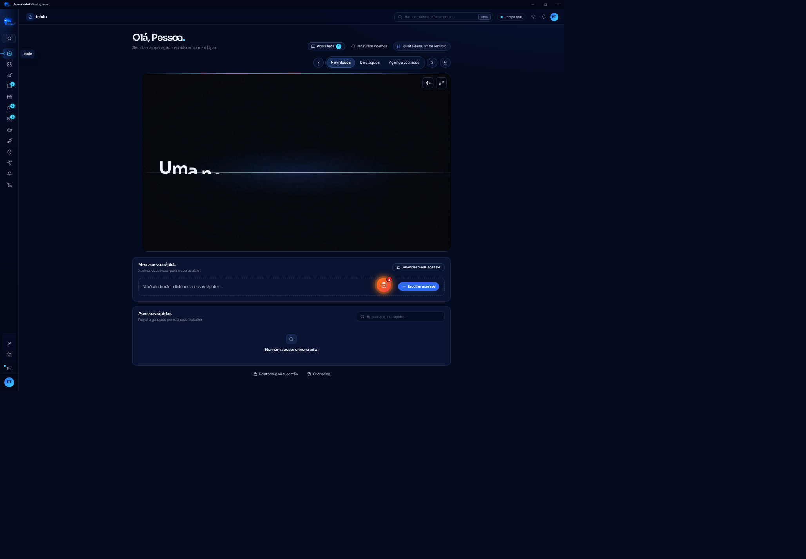

# Workscape ISP Platform

Aplicativo desktop (Electron + React + TypeScript) que reúne, em um só lugar, as ferramentas do dia a dia de um provedor de internet por fibra óptica: chat interno, agenda de técnicos, painel de operação (NOC), ferramentas de rede, telefone SIP próprio, assistente de IA e módulo de cursos.

Foi construído para substituir um conjunto de sistemas separados (intranet, agenda, dashboard) por um único app, com atualização automática e controle de acesso por perfil.

> Projeto real em uso interno. Os dados de exemplo nas capturas de tela são fictícios.



## Principais módulos

| Módulo | O que faz |
|---|---|
| **Chat interno** | Conversas em tempo real (Socket.IO), anexos, encaminhamento, avisos internos e janelas destacáveis. |
| **Agenda de técnicos** | Agendas de manutenção e instalação, equipes, ausências, mapa de chamados (Leaflet) e coordenação de rota. |
| **Painel NOC** | Indicadores operacionais em tempo real, com diagnóstico da conexão com a fonte de dados. |
| **Chamados e SGP** | Integração com o sistema de gestão do provedor para consultar e abrir chamados. |
| **Workscape Phone** | Softphone SIP embutido, com motor próprio em C++ ([Workscape-SIP-Engine](https://github.com/Olukasao/Workscape-SIP-Engine)). Ligações, histórico, Não perturbe e janela flutuante. |
| **Assistente de IA** | Assistente com memória, explicação de erros de rede, ditado por voz e modelo local opcional (llama.cpp). |
| **Cursos (LMS)** | Trilhas, aulas, provas, certificados e tutor de IA, com painel de administração. |
| **Ferramentas de rede** | Utilitários de diagnóstico e atalhos para os sistemas da operação. |
| **Lembretes** | Alarmes e lembretes pessoais, com apoio de IA. |

## Arquitetura

```text
┌──────────────────────── Electron ────────────────────────┐
│  main (electron/)            preload          renderer   │
│  • janelas e navegação       • API mínima     • React 19 │
│  • política de segurança       exposta via    • React     │
│  • atualizador assinado        contextBridge    Router   │
│  • processo do telefone      • IPC validado   • Zustand  │
│                                com zod         • Tailwind │
└──────────┬───────────────────────────────────────────────┘
           │ stdin/stdout (JSON por linhas)
           ▼
   workscape-phone-engine  (C++ / PJSUA2)  ──►  central SIP
```

- **`electron/`**: processo principal. Política de navegação e de IPC, janelas destacáveis, telefone, VPN, atualizações e integrações.
- **`src/`**: interface em React, organizada em `modules/` (telas), `components/`, `services/`, `stores/` (Zustand) e `styles/` (tokens de design com tema escuro e claro).
- **`gateway/`**: gateway local usado em desenvolvimento e testes.
- **`deploy/updates/`**: servidor de distribuição de atualizações (veja abaixo).
- **`tests/`**: testes unitários, de integração e de interface.

## Segurança

- **`contextIsolation` ativo e API mínima no preload.** O renderer não acessa Node.js.
- **Todo IPC é validado com zod**, e comandos sensíveis só aceitam a janela principal.
- **Política de navegação e de origens**: o app só abre e carrega destinos previstos.
- **Atualizações assinadas.** O instalador novo só é aceito se a assinatura bater com a chave pública embutida no app (`updateSignature`, `updateTrust`), com política de versão mínima para forçar atualizações críticas.
- **Telefone isolado em processo próprio.** A senha SIP chega ao motor só na memória e nunca vai para logs. No servidor, ela é guardada cifrada (AES-256-GCM).
- **Build com verificação de segredos**: o `npm run build` procura padrões de segredos antes de gerar o app.

## Atualização automática

O app consulta um servidor interno de distribuição (`deploy/updates/`) que serve os instaladores e um manifesto assinado. A publicação de uma versão gera os arquivos, calcula os hashes e assina o manifesto. Detalhes em [deploy/updates/README.md](deploy/updates/README.md).

## Como rodar

Requer Node.js 24 e npm.

```bash
npm install
npm run dev          # Vite em 127.0.0.1:5178 + Electron com recarga
npm run build        # TypeScript, frontend, main/preload e verificação de segredos
npm run dist:win     # instalador NSIS e versão portátil (Windows x64) em release/
```

Testes:

```bash
npm test             # unitários e de integração (Vitest)
npm run test:e2e     # interface com Playwright (antes: npx playwright install chromium)
npm run test:desktop # Electron real com APIs locais isoladas (precisa de ambiente gráfico)
```

> Os endereços dos serviços internos (chat, agenda, dashboard) ficam em `electron/agendaDeployment.ts` e `electron/policy.ts`. Para rodar fora da rede original é preciso apontá-los para os seus próprios serviços.

### Motor do telefone

O executável `workscape-phone-engine.exe` não é versionado aqui. Ele vem do Release do repositório [Workscape-SIP-Engine](https://github.com/Olukasao/Workscape-SIP-Engine) e deve ser colocado em `resources/phone-win-x64/` antes de gerar o instalador. Sem ele, o módulo de telefone fica indisponível. O modelo local de IA (llama.cpp) também não é versionado e fica em `resources/llama-win-x64/`.

## Stack

- **App**: Electron, React 19, TypeScript, Vite, React Router, TanStack Query, Zustand, Tailwind CSS, Radix, Framer Motion, Leaflet, Socket.IO client, zod.
- **Distribuição**: electron-builder (NSIS), electron-updater, servidor de atualização próprio em Node.
- **Telefonia**: C++17, PJSIP/PJSUA2, protocolo JSON por linhas.
- **Qualidade**: Vitest, Playwright, TypeScript estrito, CI no GitHub Actions.

## Estrutura

```text
electron/        processo principal, preload e políticas
src/modules/     telas (chat, agenda, NOC, cursos, assistente, telefone…)
src/components/  componentes compartilhados
src/services/    clientes de API e regras de negócio do front
src/stores/      estado global (Zustand)
gateway/         gateway local de desenvolvimento
deploy/updates/  servidor e publicação de atualizações
resources/       binários empacotados com o instalador
docs/            notas técnicas e engenharia reversa do softphone
tests/           testes
```

## Estado do projeto

Em uso interno e em evolução contínua (versão 0.5.x). O histórico de mudanças em linguagem simples fica em [src/changelog.ts](src/changelog.ts).

## Licença

Projeto proprietário de uso interno, publicado para fins de portfólio. O código não tem licença de uso aberta: sem autorização, não copie, redistribua nem use comercialmente. O softphone liga o PJSIP (GPL v2 ou licença comercial), como detalhado no repositório do motor.
